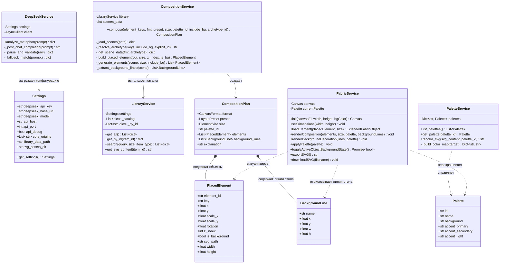

# UML Архитектура проекта: Vector Illustration Composer

Диаграмма архитектуры и взаимодействия компонентов системы генерации векторных композиций по спецификации Figma Section 1.

---

## Ключевые компоненты архитектуры:

1. **`CompositionService` (Services/Layout Engine):**
   - 100% совпадение с Section 1 Figma макета:
     - 6 канонических архетипов в 3 форматах (всего 18 сцен):
       - *Ряд 1 («Только главные»):* `phone_puzzle`, `book_phone`, `folder_wallet_coin`.
       - *Ряд 2 («С фоновыми»):* `vase_headphones` (ваза mono), `lamp_wallet_coin` (лампа mono), `book_puzzle_pen` (книга mono).
     - Попиксельная привязка к левому верхнему углу (`originX: left, originY: top`).
     - Натуральный масштаб элементов ($1.0$).
     - Отрисовка изометрических линий стола (угол $30^\circ$) и декоративных конфетти.

2. **`FabricService` (Frontend Canvas Controller):**
   - Инкапсулирует работу с Fabric.js и SVG DOM.
   - Поддерживает переключение состояния активного объекта `Главный ⇄ Фоновый` в реальном времени.
   - Семантическая перекраска по палитрам Figma.
   - Экспорт в чистый векторный SVG вместе с фоновыми направляющими.

3. **`DeepSeekService` (Metaphor Semantic Engine):**
   - Анализирует свободный текстовый бриф пользователя.
   - Автоматически сопоставляет запрос с подходящим каноническим архетипом.
   - Поддерживает все 10 объектов библиотеки, включая вазу с тюльпанами (`vase`).
